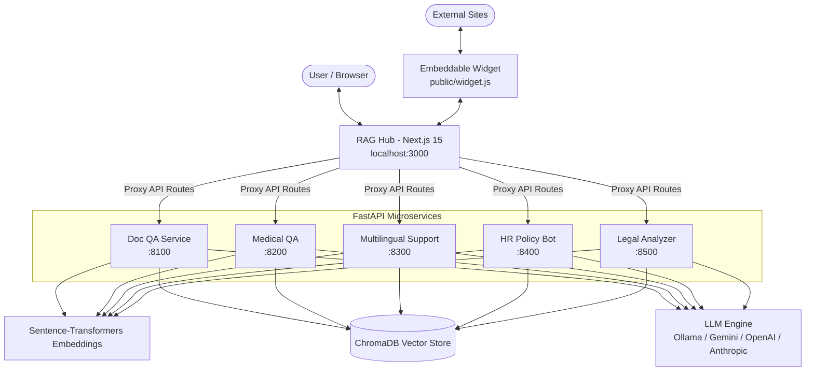

# RAG Solutions Suite 🚀

> **Production-ready, multi-tenant Retrieval-Augmented Generation (RAG) microservices suite with unified Next.js dashboard, streaming responses, and hybrid document intelligence.**

[](https://fastapi.tiangolo.com)
[](https://nextjs.org)
[](https://www.trychroma.com/)
[](LICENSE)
[](https://www.python.org/)

<div align="center">
  
</div>

---

## 📌 Overview

**RAG Solutions** is a modular mono-repository showcasing specialized, domain-engineered RAG microservices built with **FastAPI**, **ChromaDB**, **Sentence-Transformers**, and local or cloud LLMs. It includes **RAG Hub**, a unified Next.js 15 web interface for real-time document ingestion, metadata inspection, streaming document Q&A, and embeddable web widgets.

### 🧩 Specialized Microservices

| Service | Port | Domain / Focus | Key Capabilities |
| :--- | :--- | :--- | :--- |
| **[`doc-qa-service`](./doc-qa-service)** | `8100` | General Document Intelligence | PDF/DOCX/TXT/MD ingestion, KV context pre-computation, structured citation linking. |
| **[`medical-records-qa`](./medical-records-qa)** | `8200` | Healthcare & Patient Records | Patient-scoped namespaces, clinical lab reference guidance, strict medical grounding refusal. |
| **[`multilingual-support-bot`](./multilingual-support-bot)** | `8300` | Global Customer Support | Auto language detection, cross-lingual semantic search, confidence score escalation checks. |
| **[`hr-policy-bot`](./hr-policy-bot)** | `8400` | Enterprise HR & Handbook | Multi-tenant company policies, leave/benefits compliance, human-agent escalation. |
| **[`legal-doc-analyzer`](./legal-doc-analyzer)** | `8500` | Legal & Contracts | Clause extraction, jurisdictional filtering (PK/US/UK), risk analysis, mandatory legal disclaimers. |
| **[`rag-hub`](./rag-hub)** | `3000` | Unified Frontend & Widget | Next.js 15 UI, SSE streaming chat, tenant selector, citation sidebars, standalone embed widget. |

---

## 🏗️ Architecture



---

## ⚡ Quick Start

### 1. Prerequisites
- **Python 3.11+**
- **Node.js 20+ & npm** (Required for Next.js 15+ / Tailwind v4)
- **LLM Provider**:
  - [Ollama](https://ollama.ai) running locally (`ollama pull qwen2.5:3b` or `llama3.2`), or
  - API key for Google Gemini, OpenAI, or Anthropic.

### 2. Clone Repository
```bash
git clone https://github.com/your-username/rag-solutions.git
cd rag-solutions
```

### 3. Running Backend Services (Example: Doc QA Service)
```bash
cd doc-qa-service
python -m venv venv

# Windows
.\venv\Scripts\activate
# Linux/macOS
source venv/bin/activate

pip install -r requirements.txt
cp .env.example .env
python main.py
```
*The service will start at `http://localhost:8100` (Interactive Swagger Docs at `http://localhost:8100/docs`).*

### 4. Running RAG Hub (Frontend Dashboard)
```bash
cd rag-hub
npm install
npm run dev
```
Open **`http://localhost:3000`** in your browser.

---

## 🔄 Switching LLM Models & Providers

All services are designed with flexible configuration. While the default uses **Ollama** for zero-cost, private, local execution, you can switch models or integrate cloud providers:

### Ollama (Default - Local)
In any service's `.env` file:
```env
OLLAMA_BASE_URL=http://localhost:11434
OLLAMA_MODEL=qwen2.5:3b   # or llama3.2, mistral, deepseek-r1:7b, etc.
```

### Extending to Cloud Providers (Gemini, OpenAI, Anthropic)
The architecture isolates the LLM generation step inside `services/rag_chain.py`. To plug in external APIs:
1. **Google Gemini**: Set `GEMINI_API_KEY` and use `google-genai` / `langchain-google-genai`.
2. **OpenAI**: Set `OPENAI_API_KEY` and point to `gpt-4o-mini` or `gpt-4o`.
3. **Anthropic Claude**: Set `ANTHROPIC_API_KEY` and stream completions from `claude-3-5-sonnet`.

*(See the [LLM Provider Integration Guide](#-recommended-enhancements) below for the recommended plug-and-play adapter pattern).*

---

## 📁 Repository Structure

```text
rag-solutions/
├── doc-qa-service/            # General document question answering
├── medical-records-qa/        # Patient clinical records & lab QA
├── multilingual-support-bot/  # Multilingual support with auto-detection & routing
├── hr-policy-bot/             # Company policy, benefits, and handbook RAG
├── legal-doc-analyzer/        # Contract analysis, clause detection & jurisdiction
├── rag-hub/                   # Next.js 15 unified dashboard and embeddable widget
├── .gitignore                 # Clean repository ignore patterns (excluding local dbs/caches)
└── README.md                  # Global documentation
```

---

## 🛠️ Features & Highlights

- **Anti-Hallucination Grounding**: Strict system prompts enforce citations (`[Source N]`) and exact refusal messages when context is insufficient.
- **Fast KV Cache Re-use**: Ollama token arrays are cached in-memory after ingest or first query, dropping follow-up response latency to 2-3s.
- **Tenant & Namespace Isolation**: Clean ChromaDB collection partitioning for tenants, departments, or patient IDs.
- **Confidence-Based Escalation**: Low similarity thresholds automatically flag queries for human agent review.
- **Cross-Lingual Retrieval**: Multilingual dense embeddings (`paraphrase-multilingual-MiniLM-L12-v2`) allow cross-lingual querying and response matching.

---

## 📄 License
This repository is licensed under the [MIT License](LICENSE).

